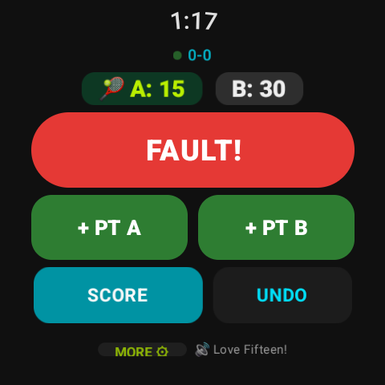
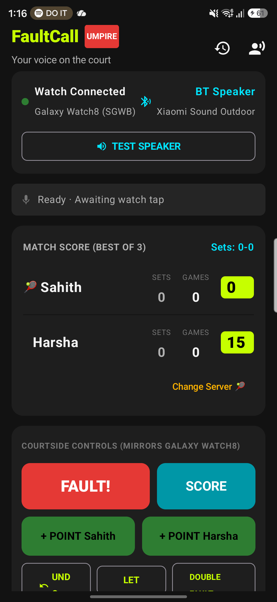
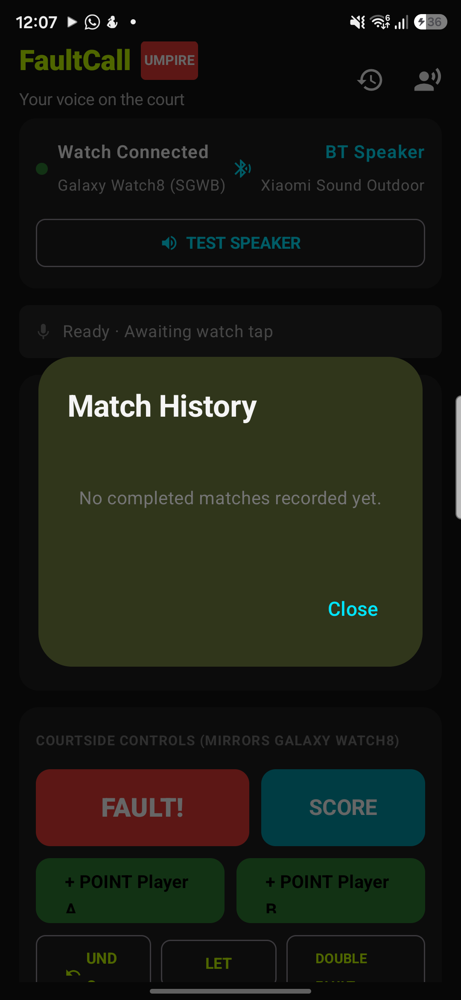

# FaultCall 🎾

> **Wear OS-Controlled Tennis Umpire & Intelligent Announcement System**

FaultCall turns your smartwatch into a courtside physical remote control while your phone operates as an authoritative tennis scoring engine and broadcasts announcements through a connected Bluetooth loudspeaker.

---

## Overview

When playing tennis, scorekeeping and line dispute calls frequently interrupt momentum. With **FaultCall**:

1. **Keep the phone in your bag or bench** paired with your portable Bluetooth speaker.
2. **Wear your smartwatch** onto the court.
3. Tap **FAULT!** on your wrist &rarr; the speaker booms **"FAULT!"** with immediate low latency.
4. Tap **+ PT A** or **+ PT B** &rarr; the score is tracked and clearly announced (e.g., *"Fifteen Love!"*, *"Deuce!"*, *"Game, Player A!"*).
5. Background music playing on your phone (e.g., Spotify) **automatically dips to 5% volume** during announcements, and **instantly returns to 100% volume** when the umpire finishes speaking.

---

## Visual Tour

| Wear OS Remote (Galaxy Watch8) | Phone Dashboard (Galaxy S24 Ultra) | Settings & Audio Controls |
| :---: | :---: | :---: |
|  |  |  |
| *Large high-contrast touch targets, tactile haptics, instant FAULT button* | *Live match score, courtside controls, Bluetooth speaker diagnostics* | *ElevenLabs AI voice integration, RP British pitch/rate, 5% music ducking* |

---

## Key Features

- **Circular Wear OS Interface**:
  - High-contrast, large touch targets designed for quick glance and sweat resistance during live play.
  - Distinct haptic patterns for point awarded, fault, undo, and set victory.
  - Rapid double-tap debounce protection preventing accidental duplicate inputs.
- **Dynamic Background Music Attenuation (5% Ducking)**:
  - System-level transient focus ducks background media apps (Spotify, YouTube Music) to ~5% volume during announcements.
  - Centralized single-request focus lifecycle guarantees **immediate, reliable volume restoration** to 100% with zero orphaned audio focus locks.
- **Flexible Voice Generation Architecture**:
  - **Local Audio Library**: Instant offline playback for primary calls (`FAULT`, `LET`, `OUT`, `DEUCE`, `ADVANTAGE`, `GAME`, `SET`, `MATCH`).
  - **ElevenLabs AI Voice ("The Authority")**: British RP umpire profile with on-device SHA-256 disk caching to prevent duplicate network calls.
  - **Android Text-to-Speech Fallback**: High-quality offline British English engine with customizable pitch, speed, and automatic space normalization.
- **Comprehensive Tennis Scoring Engine**:
  - Standard points (Love, 15, 30, 40, Deuce, Advantage).
  - Standard 7-point tiebreak (at 6-6) and 10-point super tiebreak with alternating service rotation rules.
  - Advantage vs. No-Ad (sudden death) scoring modes.
  - Unlimited snapshot-based undo history.
- **Courtside Wake-on-Tap Reliability**:
  - Smartwatch actions wake up the phone app even when the phone screen is locked or asleep.
  - High-priority calls (such as `FAULT!`) immediately preempt ordinary score announcements in the priority queue.

---

## Pre-Built Release Packages

Ready-to-install debug APKs are available in the [`releases/`](releases/) directory:

- 📱 **Phone App**: [`FaultCall-Mobile-v1.0.0.apk`](releases/FaultCall-Mobile-v1.0.0.apk) (~17.2 MB)
- ⌚ **Galaxy Watch8 (Wear OS 5)**: [`FaultCall-GalaxyWatch8-v1.0.0.apk`](releases/FaultCall-GalaxyWatch8-v1.0.0.apk) (~20.7 MB)
- ⌚ **Galaxy Watch5 Pro (Wear OS 4.5)**: [`FaultCall-GalaxyWatch5Pro-v1.0.0.apk`](releases/FaultCall-GalaxyWatch5Pro-v1.0.0.apk) (~20.7 MB)
- ⌚ **Wear OS Universal (Pixel Watch, TicWatch)**: [`FaultCall-Wear-Universal-v1.0.0.apk`](releases/FaultCall-Wear-Universal-v1.0.0.apk) (~20.7 MB)

*For checksums and detailed package info, see [RELEASES.md](RELEASES.md).*

---

## Quick Start & Sideloading

### Step 1: Install Phone App
```bash
adb install -r releases/FaultCall-Mobile-v1.0.0.apk
```

### Step 2: Install Watch App (over Wi-Fi)
1. On your Wear OS watch, navigate to **Settings > Developer options > Wireless debugging**.
2. Note the IP address, port, and pairing code.
```bash
# Pair with the watch
adb pair <WATCH_IP>:<PAIR_PORT> <PAIR_CODE>

# Connect to the watch
adb connect <WATCH_IP>:<CONNECT_PORT>

# Sideload the APK
adb -s <WATCH_IP>:<CONNECT_PORT> install -r releases/FaultCall-GalaxyWatch8-v1.0.0.apk
```

---

## Building from Source

### Prerequisites
- JDK 17
- Android SDK 34 (API 34)

### Build Commands
```bash
# Clone the repository
git clone https://github.com/<your-username>/FaultCall.git
cd FaultCall

# Run shared unit test suite
./gradlew :shared:test

# Build all debug APKs
./gradlew assembleDebug
```

Compiled APKs will be located in:
- `mobile/build/outputs/apk/debug/mobile-debug.apk`
- `wear/build/outputs/apk/debug/wear-debug.apk`

---

## Project Structure

```
FaultCall/
├── mobile/                  # Android Phone application (Jetpack Compose, Audio Focus)
├── wear/                    # Wear OS smartwatch interface (Wear Compose, Haptics)
├── shared/                  # Kotlin Multiplatform core (Scoring rules, State machines, Protocol)
├── server/                  # Optional Python ElevenLabs proxy server
├── releases/                # Release binaries and SHA-256 checksums
├── docs/                    # Architecture diagrams, installation guides, screenshots
├── .github/workflows/       # GitHub Actions CI workflow
├── build.gradle.kts         # Root Gradle build script
└── settings.gradle.kts      # Project module configurations
```

---

## License

This project is licensed under the [MIT License](LICENSE).
